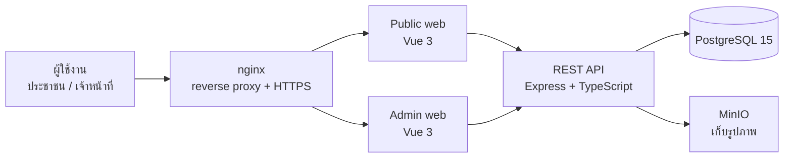

# ชุมชนดีดี (Dee Dee Local Life)

ระบบเว็บบริหารจัดการชุมชน เชื่อมประชาชน ร้านค้า และเจ้าหน้าที่เข้าด้วยกัน ครอบคลุมประกาศ กิจกรรม ร้านค้าและรีวิวบนแผนที่ จุดทิ้งขยะและการรายงานปัญหาขยะ และการจัดเก็บค่าธรรมเนียมขยะรายครัวเรือน

**เว็บไซต์สาธิต (Live demo):** https://zeenontakorn-demo.xyz/
**สถานะ:** deploy เป็นระบบ demo บน server ของตัวเอง (ยังไม่มีผู้ใช้งานจริง)
**ลักษณะงาน:** โปรเจกต์ทีม (ผู้ร่วมพัฒนากว่า 7 คน) ผมร่วมพัฒนาและรับผิดชอบบางโมดูลตามด้านล่าง
**โค้ด:** อยู่ใน private repository ของทีม ยินดีสาธิตและอธิบายโค้ดในการสัมภาษณ์

---

## สถาปัตยกรรม

ระบบหลายบริการ รันด้วย Docker Compose (โหมด dev / infra / production)

| ส่วน | เทคโนโลยี | หน้าที่ |
|---|---|---|
| Backend | Node.js, Express, TypeScript, Prisma | REST API, เอกสาร API ด้วย Swagger |
| Validation / Auth | Zod, JWT, CASL | ตรวจข้อมูลขาเข้า, ยืนยันตัวตน, กำหนดสิทธิ์ตามบทบาท |
| Admin frontend | Vue 3, TypeScript, Vite, Tailwind, Pinia, Leaflet | จัดการประกาศ ร้านค้า ครัวเรือน ค่าธรรมเนียม รายงาน |
| Public frontend | Vue 3, TypeScript, Vite, Tailwind, Pinia, Leaflet | ประชาชนดูประกาศ ค้นหาร้านค้าบนแผนที่ รีวิว รายงานปัญหาขยะ |
| ฐานข้อมูล | PostgreSQL 15 (+ pgAdmin) | ข้อมูลหลัก |
| Object storage | MinIO | เก็บรูปภาพที่อัปโหลด |
| Reverse proxy | nginx | ตั้งค่าสำหรับ deploy |

**วิธีทำงานของทีม:** แตก branch `feature/…` / `fix/…` ตามเลข ticket แล้วเปิด Pull Request เข้า `development` ก่อน release เข้า `main`

---

## ส่วนที่ผมรับผิดชอบ

### 1. โมดูลค่าธรรมเนียมขยะ (ใบแจ้งหนี้รายเดือนต่อครัวเรือน)
ทำทั้ง backend และหน้าจอเจ้าหน้าที่ ส.ค.–ก.ย. 2568 (2025)

- **Backend (Express + Prisma):** โมดูลแยก controller / routes / schemas / service ประมาณ 1,450 บรรทัด มี 10 endpoint
- กำหนดอัตราค่าธรรมเนียมต่อครัวเรือน (จำนวนเงินเริ่มต้น, ประเภทค่าธรรมเนียม, วันที่เริ่มใช้) และสร้างใบแจ้งหนี้รายเดือน โดยตรวจว่าเดือนนั้นอยู่หลังวันที่เริ่มใช้อัตรา
- ติดตามสถานะ **ชำระแล้ว / ค้างชำระ** และอัปเดตสถานะพร้อมบันทึกผู้ทำรายการ (audit)
- ค้นหา กรองตามเดือน สถานะ หมู่ที่ และที่อยู่ พร้อม pagination และการเรียงลำดับ
- สรุปยอดชำระแล้วและยอดค้างชำระเป็นการ์ดสรุปในหน้าแดชบอร์ด
- **Frontend (Vue 3):** หน้าจัดการค่าธรรมเนียม หน้าแก้ไขใบแจ้งหนี้ และเมนู "ข้อมูลครัวเรือน (ค่าธรรมเนียมขยะ)" ในหน้าตั้งค่า

### 2. ฝั่งประชาชน: ร้านค้าและแผนที่
- หน้าร้านค้าและรีวิวร้านค้าของประชาชน
- หน้าขอเข้าร่วมร้านค้า เมื่อเลือกแผนที่จะปักหมุดที่ตำแหน่งผู้ใช้ตั้งแต่แรก และเพิ่มบทบาท vendor ให้ผู้ยื่นขอเข้าร่วม

### 3. แก้ไขข้อผิดพลาดจากรอบทดสอบและเตรียม deploy มิ.ย.–ส.ค. 2569 (2026)
หลังนักศึกษาฝึกงานทดสอบระบบและบันทึกปัญหาไว้ในบอร์ดงาน ผมดำเนินการแก้ไขรายการที่พบ รวม 38 รายการ และปรับให้ระบบ deploy บน server ได้

---

## ตัวอย่างปัญหาที่แก้ (จัดกลุ่มจาก 38 รายการ)

| กลุ่ม | ตัวอย่าง |
|---|---|
| แผนที่และพิกัด | เครื่องมือวาดพื้นที่ในหน้าประกาศใช้งานไม่ได้, หมุดเคลื่อนตำแหน่งเมื่อซูมแผนที่, เลือกร้านจากรายการแล้วแผนที่ไม่เลื่อนไปที่หมุด |
| การยืนยันตัวตนและสิทธิ์ | ได้รับสิทธิ์แล้วต้อง logout/login ใหม่โดยไม่มีข้อความแจ้ง, แจ้งเตือนซ้ำหลังอนุมัติ, login ฝั่ง user กับ admin พร้อมกันแล้วเด้งออกทั้งคู่ |
| กฎทางธุรกิจ | ป้องกันการรีวิว/รายงานร้านค้าของตัวเอง, ยื่นเรื่องใหม่ได้หลังถูกปฏิเสธ, ประกาศหมดอายุแล้วยังแสดงอยู่, ระบุเหตุผลเมื่อระงับชุมชน |
| ฟิลเตอร์และ pagination | ฟิลเตอร์สถานะ/ช่วงวันที่ของประกาศกรองไม่ตรง, กดเปลี่ยนหน้ารีวิวแล้วข้อมูลไม่เปลี่ยน, ดาวแสดงไม่ตรงกับคะแนน |
| อัปโหลดไฟล์ | อัปโหลดรูปไม่ได้ ทำให้ส่งคำขอเข้าร่วมร้านค้าไม่ได้ |
| UI/UX และ responsive | ปรับ layout การแสดงรูป, ข้อความยาวล้นกรอบ, หน้าจอ responsive ฝั่งประชาชน, หน้าค่าธรรมเนียมสไตล์ไม่เหมือนหน้าอื่น, empty state เมื่อไม่มีเมนูแนะนำหรือยังไม่มีประเภทร้านค้า |

---

## ปัญหาที่ท้าทาย: เว็บล่มหลัง VPS รีบูต

**อาการ:** เว็บ demo เปิดไม่ได้ ขึ้น connection error และ 502 ทั้งที่ผมไม่ได้ deploy อะไรเลย

**การไล่หาสาเหตุ:** ผู้ให้บริการ VPS แจ้งว่ามีการรีบูตโฮสต์เพื่อแพตช์ช่องโหว่ของเคอร์เนล ผมจึงตรวจสอบจากชั้นนอกเข้าสู่ชั้นใน คือเครือข่ายและ DNS, nginx บนเครื่อง และคอนเทนเนอร์ พบว่า nginx ไม่ได้ตั้งให้เปิดตอนบูต และคอนเทนเนอร์ของ backend, frontend และ MinIO หยุดอยู่ มีเพียง PostgreSQL กับ pgAdmin ที่กลับมาทำงานเองได้ เพราะเป็น service ที่ตั้ง `restart: unless-stopped` ไว้ ส่วนตัวอื่นไม่ได้ตั้ง

**วิธีแก้:** เปิด nginx พร้อมตั้งให้เริ่มทำงานตอนบูต (`systemctl enable`) เริ่มคอนเทนเนอร์ที่หยุดอยู่ตามลำดับ (MinIO และ backend ก่อน แล้วค่อย frontend) แล้วเพิ่ม `restart: unless-stopped` ให้ทุก service ของ production ในไฟล์ Docker Compose

**สิ่งที่ได้เรียนรู้:** การดูแลระบบหลัง deploy ต้องคิดถึงเหตุที่เราควบคุมไม่ได้ เช่น การอัปเดตอัตโนมัติและการรีบูตโดยผู้ให้บริการ ไม่ใช่แค่ทำให้ระบบขึ้นได้ครั้งแรก ตอนนี้ระบบฟื้นตัวเองได้หลังเครื่องรีบูต

---

## สิ่งที่ได้ฝึก
- ทำงานในทีมหลายคนด้วย feature branch และ Pull Request
- deploy ระบบด้วย Docker บน VPS ที่เช่าเอง พร้อมตั้งค่า nginx reverse proxy โดเมน และ HTTPS
- ดูแลระบบหลัง deploy: เมื่อ VPS รีบูต บริการบางตัวไม่ขึ้นเอง จึงตรวจสอบสาเหตุและกำหนด restart policy ของคอนเทนเนอร์ให้ฟื้นตัวเองได้
- ออกแบบ API และ query ด้วย Prisma + PostgreSQL ในโมดูลที่มีความสัมพันธ์หลายตาราง
- ทำงานกับระบบสิทธิ์ตามบทบาท (CASL) และการยืนยันตัวตนด้วย JWT
- ทำงานกับแผนที่ (Leaflet) การอัปโหลดไฟล์ (MinIO) และ responsive design
- รับ feedback จากผู้ทดสอบและแก้ไขตามลำดับความสำคัญ

## ขั้นต่อไปที่วางแผน
- SEO: เตรียมค่าพื้นฐานไว้แล้ว (title/description, robots.txt, sitemap, Search Console) อยู่ระหว่าง deploy เพื่อให้ค้นหาระบบบน Google เจอ
- วัดคะแนนด้วย Lighthouse และปรับปรุง performance
- เขียน automated test และเพิ่ม CI